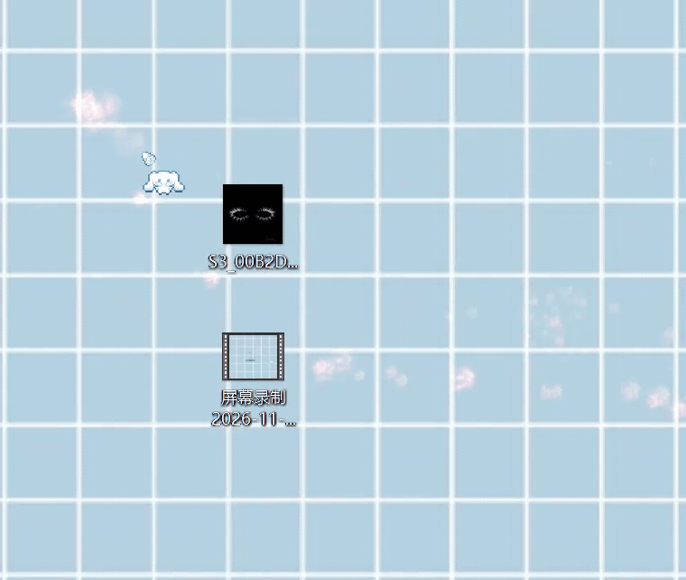
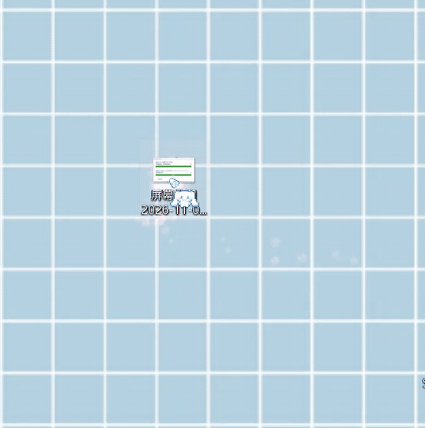
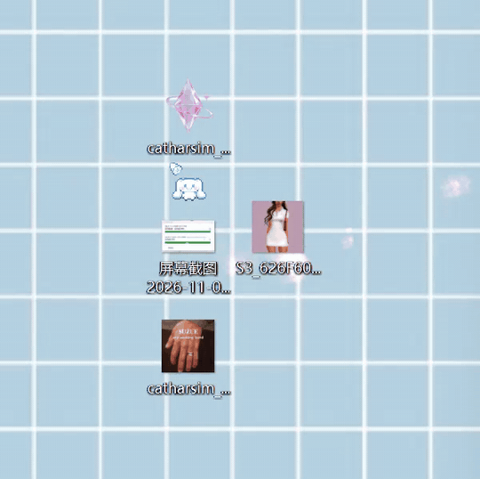
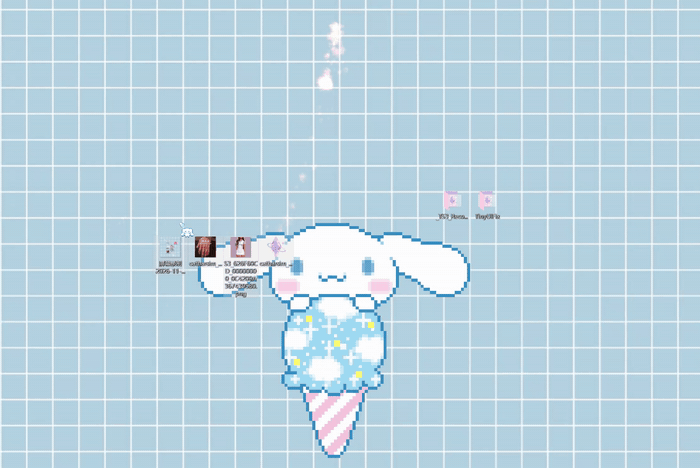
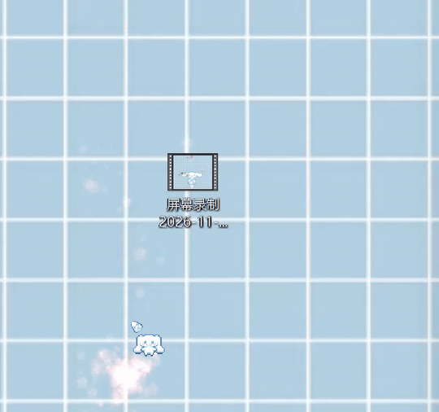

# Drag & Trash · 一拖即删

**Drag less. Trash faster.**

回收站可跟随鼠标或显示在附近/顶部，支持自定义静态/动态图标，并保留批量删除与 Ctrl+Z 撤销。

## How it works / 如何使用

### 01 · Follow the cursor / 跟随鼠标

The target follows your cursor, then pauses as you approach it to make dropping easy.
拖动时跟随鼠标，靠近目标时停住，方便准确放入。

### 02 · Near the drag start / 起点附近

The target appears beside the starting point, so you don't have to drag across the screen.
在拖拽起点附近显示，缩短拖动距离。

### 03 · Top of screen / 屏幕顶部

Prefer the classic placement? Keep the original top-of-screen option.
喜欢原版的位置？可以继续将目标固定在屏幕顶部。

### 04 · System or custom icon / 系统或自定义图标

Use the Windows Recycle Bin icon, a local PNG/JPG/BMP/ICO/GIF, or a user-selected HTTPS image URL loaded in the background.
可使用 Windows 回收站图标、本地图片或 GIF 动图，也可后台加载 HTTPS 图片直链。

## More / 其他功能

- **Hover icon / 悬停图标:** Set an optional local PNG/JPG/BMP/ICO/GIF for hover. Leave blank to reuse the drag icon.
- **Automatic mirroring / 位置自动翻转:** By default, a target to the cursor's left mirrors horizontally; while hovering, orientation stays stable.

- **Start Menu search / 开始菜单搜索:** Recycle real files and folders dragged from Everything & Power Tools in the Start Menu (local v1.2.1 only).
- **Batch recycling / 批量回收:** Drop several files together in one Shell operation.
- **Ctrl+Z undo / 撤销:** Restore a supported recycle operation in File Explorer (within the active Shell session).
- **Lightweight / 轻量:** GIF playback runs only while dragging. HTTPS images load on a bounded background worker and are cached locally, never blocking dragging.

## Credits & license / 原作者与授权

**Based on [Drag to Delete](https://github.com/ramensoftware/windhawk-mods/blob/main/mods/drag-to-delete.wh.cpp) by [iMAboud](https://github.com/iMAboud).**

This mod reuses and modifies the original MIT-licensed drag-and-drop and recycle implementation, with attribution to its author. The adaptation adds cursor-following and nearby placement, retains the original top placement, and introduces configurable still/animated icons and batch/undo improvements. The original author is not affiliated with or endorsing this adaptation.

本 Mod 基于 iMAboud 的 Drag to Delete 开源代码修改，保留原作者署名和 MIT 授权说明。新版加入鼠标跟随、起点附近模式、自定义静态/动态图标，以及批量回收和撤销改进；原版顶部位置仍可选择。

**GIFs not loading?** [Nearby](https://raw.githubusercontent.com/xandri19wang/drag-and-trash/main/demos/nearby.gif) · [Follow](https://raw.githubusercontent.com/xandri19wang/drag-and-trash/main/demos/follow-cursor.gif) · [Top](https://raw.githubusercontent.com/xandri19wang/drag-and-trash/main/demos/screen-top.gif) · [System icon](https://raw.githubusercontent.com/xandri19wang/drag-and-trash/main/demos/system-icon.gif).

**Note / 注意:** Virtual desktop icons without real file paths cannot be recycled. Ctrl+Z may not work after Explorer restarts or the Recycle Bin is emptied. No third-party GIFs are included with the mod.
